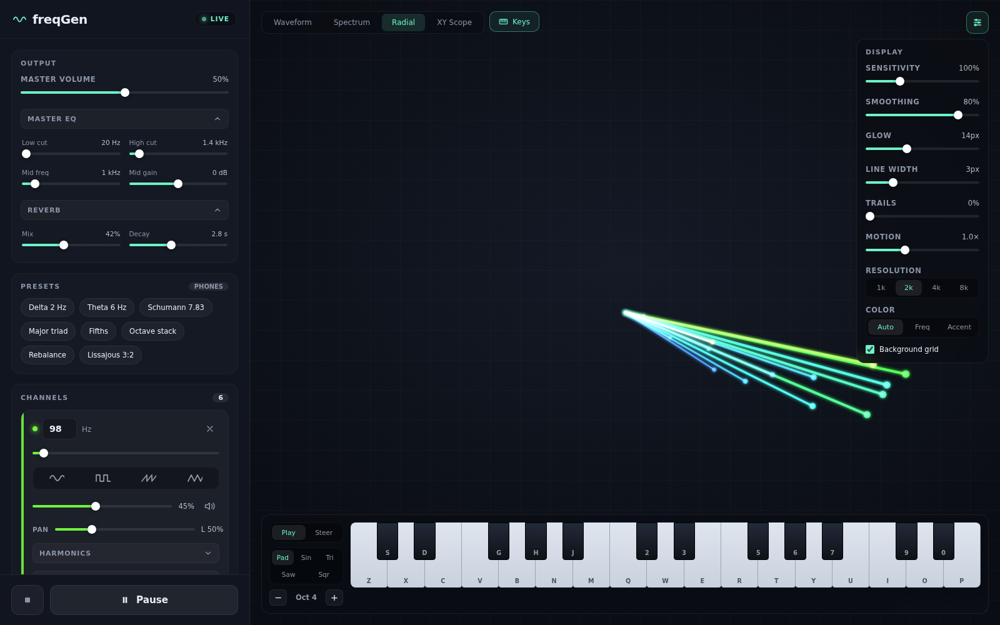

# freqGen

A client-side drone synthesizer and tone generator with live visualizers. Stack detuned voices, add slow swells and reverb, then steer the whole instrument from your keyboard.

**Try it live: https://ramigb.github.io/freqGen/ · Source: https://github.com/ramigb/freqGen**

[](https://ramigb.github.io/freqGen/)
[](https://developer.mozilla.org/en-US/docs/Web/API/Web_Audio_API)
[](https://github.com/ramigb/freqGen)



## Features

- **Channels** — multiple oscillators, each with frequency (20 Hz–2 kHz), pan, volume, mute, and per-channel EQ/filters
- **Waveforms** — sine, square, sawtooth, triangle, or custom additive waves via 8 harmonic partial sliders
- **Voices / Detune** — stack up to 3 oscillators per channel with a cent-spread for instant chorus/pad thickness
- **Sweep** — frequency glides between two values, once or looping
- **Swell** — slow LFO breathing on each channel's gain (rate + depth)
- **Master section** — volume, 3-band EQ (low cut, high cut, peaking mid), and a convolution reverb (mix + decay)
- **Presets** — binaural-beat pairs, chord stacks, and "Rebalance" (a detuned C-add9 drone; headphones recommended) — plus **save/load your own**, stored locally in the browser
- **Piano play mode** — on-screen piano plus computer-keyboard input (Z/Q rows), polyphonic, with 12 voices (Pad, Organ, E.Keys, Bell, Bass, Pluck, Lead, Flute, plus raw waves), octave shift, and a **Sound panel** for attack/decay/sustain/release, vibrato rate/depth, and brightness
- **Recorder** — capture the full output mix (channels, keys, EQ, reverb) from the transport bar, to lossless **WAV** or your browser's compressed format (WebM/OGG/M4A)
- **Steer mode** — held keys magnetically glide every running channel to the nearest held pitch class; releasing slides them home
- **Visualizers** — waveform, spectrum, radial burst, and XY scope (Lissajous), with a Display dock for sensitivity, smoothing, glow, line width, trails, motion, FFT resolution, and color mode

## Running locally

1. Serve the root directory (any static server works):
   ```bash
   python -m http.server 8000
   ```
2. Open http://localhost:8000 in your browser, allow audio playback, and press **Play**.

## Controls quick reference

- **Space** — play/pause
- **Keys toggle** — show/hide the piano bar
- Piano keyboard: `Z..M` lower octave, `Q..P` upper octaves, `←/→` octave shift
- **Play / Steer** seg in the piano bar — play notes directly, or steer live channels toward held notes

## Notes

- Audio contexts must start from a user action; use the Play button (or press a piano key) if audio is suspended.
- Binaural presets need headphones to hear the beat.
- The page is entirely client-side—no backend required.

---

Enjoying freqGen? [Star the repo](https://github.com/ramigb/freqGen) or share the live link — the whole instrument is three static files and a browser.

**Links:** [Live demo](https://ramigb.github.io/freqGen/) · [Source code](https://github.com/ramigb/freqGen) · [Issues & ideas](https://github.com/ramigb/freqGen/issues)

*Vision by [Rami GB](https://github.com/ramigb) · execution by [Devin](https://devin.ai) (SWE-2).*
